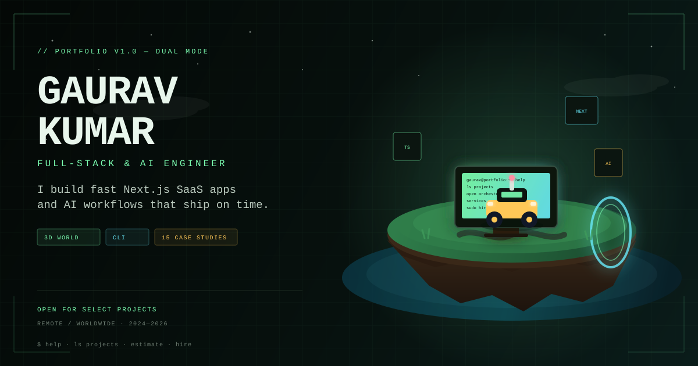

# Gaurav Kumar — Dual-Mode Freelance Portfolio

<p align="center">
  
</p>

<p align="center">
  <sub>Banner source: <code>public/banner.svg</code> · PNG export: <code>public/banner.png</code></sub>
</p>

A terminal portfolio that works for **non-technical buyers** and **developers** at the same time.

- **Fast mode** — a responsive 2D site with a working CLI, case studies, services, and a budget estimator.
- **3D mode** — a low-poly “tech island” built with React Three Fiber, Rapier physics, a drivable rover, and four interactive zones.
- **Bi-directional sync** — CLI commands fly the 3D camera; clicking a 3D landmark runs the matching command or opens the matching panel.
- **Zero-friction CLI** — every key command also has a clickable chip, and `Ctrl/Cmd + K` opens a command palette.

Built with **Next.js 16**, **React 19**, **TypeScript**, **Tailwind CSS v4**, **shadcn/ui**, **Framer Motion**, **Zustand**, **Three.js**, **React Three Fiber**, **Drei**, and **Rapier**.

---

## What is inside

| Area | Details |
| --- | --- |
| **Dual-mode shell** | `Fast` and `3D` toggle in the top-right HUD. Fast mode is the default and the automatic fallback for mobile / low-end GPUs. |
| **Interactive CLI** | `help`, `ls projects`, `open <slug>`, `services`, `estimate`, `stats`, `skills`, `drive`, `cd <zone>`, `mode <fast\|3d>`, `theme <name>`, `contact`, `clear`, `sudo hire-me`, plus `whoami`, `neofetch`, `history`, and more. |
| **Clickable chips** | The hero terminal and 3D dock render one-click command chips so buyers never have to guess. |
| **Case studies** | 15 projects with role, year, problem, approach, measurable outcome, metrics, stack, live demo, and source. |
| **Services** | Basic / Standard / Premium packages with fixed scope, timeline, outcome, and CTA. |
| **Estimator** | A 3-step scope → timeline → integrations wizard that prints a budget range and a copyable brief for Fiverr or email. |
| **3D world** | A low-poly archipelago with four connected islands (Tech Island, Game Island, AI Lab, Data Harbor), a drivable rover with brakes/boost/headlights, Rapier physics, knockable skill blocks, and a touch joystick. |
| **Command palette** | `Ctrl/Cmd + K` to jump to commands, projects, themes, or sections. |
| **Themes** | `matrix`, `mocha`, `cyber`, and `minimal` (light). Persisted in localStorage. |
| **Sound** | Subtle Web Audio key clicks, camera whooshes, and collision thuds. Muted by default; toggle in the HUD. |
| **Motion** | Framer Motion for boot lines, staggered reveals, dialogs, estimator steps, and the celebration. Respects `prefers-reduced-motion`. |
| **SEO** | Metadata, Open Graph, generated `/opengraph-image`, `robots.txt`, `sitemap.xml`, and JSON-LD. |
| **Responsive** | 320px → 1440px. Mobile navigation uses a shadcn Sheet; the 3D stage adds a touch joystick. |
| **Profile page** | `/profile` keeps the animated scroll-triggered profile page. |
| **GitHub profile kit** | `profile/` contains a ready-to-publish profile README and animated SVG assets. |

---

## Commands

| Command | What it does |
| --- | --- |
| `help` | Lists every command with descriptions. |
| `about` | Flies to the hero/desk zone and shows the short bio. |
| `ls [projects\|pinned\|ai\|fullstack\|infra\|realtime]` | Lists case studies. |
| `open <slug>` / `cat <slug>` | Opens the case study modal and prints the outcome, metrics, stack, and links. |
| `services` | Opens the three freelance packages. |
| `estimate` | Launches the 3-step estimator. |
| `stats` | Fetches live GitHub stats and shows availability. |
| `skills` | Flies to the physics skill playground and prints the stack. |
| `cd <hero\|projects\|skills\|services\|contact>` | Moves the camera to a zone. |
| `drive` | Enters the 3D world and enables rover controls. |
| `game` | Flies to Game Island, resets the ring run, and shows the score. |
| `ai` | Flies to the AI Lab. |
| `data` | Flies to the Data Harbor. |
| `score` | Shows the Game Island ring score. |
| `mode <fast\|minimal\|3d>` | Switches between the 2D site and the 3D world. |
| `theme <matrix\|mocha\|cyber\|minimal>` | Changes the palette. |
| `contact` / `hire` | Opens the hire brief, Fiverr link, Calendly link, and email form. |
| `clear` | Clears terminal history. |
| `sudo hire-me` | Easter egg: confetti + booking brief. |
| `palette` | Opens the command palette. |
| `whoami`, `neofetch`, `history`, `date`, `pwd`, `echo` | Shell conveniences. |

**Keyboard:** `↑`/`↓` history · `Tab` autocomplete · `Ctrl/Cmd + K` palette · `Ctrl/Cmd + L` clear · `/` focus terminal.

**3D rover controls:** `WASD` / arrows drive · `Space` brake · `Shift` boost · `L` headlights · `H` horn · `R` reset. Drag to orbit. On mobile, use the joystick and the brake / boost / lights buttons.

---

## Run locally

```bash
npm install
npm run dev
```

Open <http://localhost:3000>.

Production build:

```bash
npm run build
npm run start
```

Lint:

```bash
npm run lint
```

---

## Environment variables

Copy `.env.example` to `.env.local` and fill in what you need.

| Variable | Purpose |
| --- | --- |
| `NEXT_PUBLIC_SITE_URL` | Canonical origin for metadata, Open Graph, robots, and sitemap. On Vercel, `VERCEL_PROJECT_PRODUCTION_URL` / `VERCEL_URL` are detected automatically. |
| `NEXT_PUBLIC_FIVERR_URL` | Replaces the Fiverr placeholder in the Hire / Estimator panels. |
| `NEXT_PUBLIC_CALENDLY_URL` | Replaces the Calendly placeholder in the Hire panel. |

No database or API key is required. The `stats` command calls the public GitHub API and degrades gracefully on rate limits.

---

## Deploy to Vercel

The repository is already connected to Vercel as a Git integration:

1. Push to `main`.
2. Vercel builds with `npm run build` and serves `.next`.
3. `vercel.json` sets security headers and static caching.
4. Add `NEXT_PUBLIC_FIVERR_URL` and `NEXT_PUBLIC_CALENDLY_URL` in the Vercel project settings when you have real links.
5. Add `NEXT_PUBLIC_SITE_URL` only if you connect a custom domain.

The existing production deployment is linked from the Vercel commit status on `main`.

---

## Project structure

```text
src/
├── app/
│   ├── layout.tsx
│   ├── page.tsx                 # renders <PortfolioHome />
│   ├── profile/page.tsx
│   └── opengraph-image.tsx
├── components/
│   ├── cli/
│   │   ├── TerminalShell.tsx
│   │   ├── CommandInput.tsx
│   │   ├── CommandChips.tsx
│   │   ├── OutputRenderer.tsx
│   │   └── useTerminal.ts
│   ├── overlays/
│   │   ├── TopHud.tsx
│   │   ├── ProjectModal.tsx
│   │   ├── ServicesPanel.tsx
│   │   ├── EstimatorPanel.tsx
│   │   ├── HirePanel.tsx
│   │   ├── CommandPalette.tsx
│   │   └── Celebration.tsx
│   ├── three/
│   │   ├── SceneStage.tsx
│   │   ├── WorldCanvas.tsx
│   │   ├── World.tsx
│   │   ├── WorldIsland.tsx
│   │   ├── GameIsland.tsx
│   │   ├── AILab.tsx
│   │   ├── DataHarbor.tsx
│   │   ├── Environment.tsx
│   │   ├── WorldPrimitives.tsx
│   │   ├── RoverController.tsx
│   │   ├── RoverHud.tsx
│   │   ├── TouchControls.tsx
│   │   ├── TouchJoystick.tsx
│   │   ├── SkillBlocks.tsx
│   │   └── CameraRig.tsx
│   ├── site/                    # fast-mode sections
│   └── terminal/                # window + typewriter
├── data/
│   ├── commands.ts
│   └── services.ts
├── store/
│   └── usePortfolioStore.ts
└── lib/
    ├── data.ts
    ├── github.ts
    ├── audio.ts
    └── site.ts
```

---

## Performance & accessibility

- 3D canvas is lazy-loaded with `next/dynamic` and `ssr: false`.
- Low-poly geometry, no real-time shadows, capped DPR, and `AdaptiveDpr`.
- `PerformanceMonitor` + `AdaptiveDpr` lower resolution on slower GPUs.
- A custom low-FPS watchdog automatically switches to fast mode if the 3D world cannot hold ~24fps.
- Fast mode is the default and the automatic fallback if WebGL fails.
- All motion respects `prefers-reduced-motion`.
- Skip link, focus states, ARIA labels, semantic headings, and keyboard-friendly controls.
- The CLI is fully usable without a mouse; the 3D world is fully usable without a keyboard via the touch joystick.

---

## Roadmap

The local `ROADMAP.md` contains the REA reverse-engineering summary, the phase-by-phase implementation checklist, the 4-week schedule, and the launch audit. It is intentionally **not committed**.

---

## Credits

- Design and code: Gaurav Kumar.
- `MeloSynthiaAI` is a pinned collaboration and credited to the original author.
- Low-poly world built procedurally with Three.js primitives — no external model downloads.