### `$ whoami`

**Gaurav Kumar** — full-stack & AI engineer. I build software that feels inevitable.

I work across AI-native products, real-time platforms, and developer infrastructure — from the first architecture sketch to a production deploy. Most of my favorite builds start with a constraint, not a framework.

<br>



<br>

### `$ cat pinned.json`

| Project | What it is | Stack | Links |
| --- | --- | --- | --- |
| **OpenDocs** | Real-time collaborative document editor with mentions, reactions, and presence. | Next.js · TypeScript · Convex · Tiptap · Liveblocks | [repo](https://github.com/ARtoRiAs10/OpenDocs) · [live](https://google-docs-clone-git-main-gaurav-kumars-projects-928a4134.vercel.app) |
| **Lingo** | Duolingo-inspired language learning with hearts, XP, streaks, leaderboards, and a shop. | Next.js · TypeScript · Drizzle · Clerk · Postgres | [repo](https://github.com/ARtoRiAs10/lingo) · [live](https://lingo-blond.vercel.app) |
| **Learnify** | Turn any YouTube video or PDF into flashcards, quizzes, and a grounded AI chat. | Next.js · FastAPI · Gemini · ChromaDB | [repo](https://github.com/ARtoRiAs10/Learnify) · [live](https://learnify-two-nu.vercel.app) |
| **DeployHub** | A Vercel-like deployment platform: push a repo or ZIP and get a live URL. | Next.js · Express · Redis · Docker · AWS S3 | [repo](https://github.com/ARtoRiAs10/DeployHub) · [live](https://deploy-hub-97j1.vercel.app) |
| **FoodVision** | Computer vision food classifier using EfficientNetB2 transfer learning. | Python · PyTorch · Gradio · Hugging Face | [repo](https://github.com/ARtoRiAs10/FoodVision) · [live](https://huggingface.co/spaces/ARtOrias11/foodvision_mini__) |
| **MeloSynthiaAI** | NFT-based AI music marketplace for generating, minting, and trading AI music. | TypeScript · Next.js · VQ-VAE · BERT · CVAE | [repo](https://github.com/ARtoRiAs10/MeloSynthiaAI) · [live](https://melosynthiaai.vercel.app) |

> **MeloSynthiaAI** is a pinned collaboration — original project by [@AYUSHMAN0503](https://github.com/AYUSHMAN0503).

<br>

### `$ ls advanced/`

| Project | What it is | Stack | Links |
| --- | --- | --- | --- |
| **Orchestra** | Distributed CI/CD control plane with DAG scheduling, worker fleets, live logs, and billing. | TypeScript · BullMQ · Redis · Postgres · Docker | [repo](https://github.com/ARtoRiAs10/Orchestra) |
| **MarketLens** | Quantitative finance SaaS with 9 strategy engines, backtesting, and portfolio optimization. | Next.js · FastAPI · Python · Postgres | [repo](https://github.com/ARtoRiAs10/market_len) · [live](https://market-len.vercel.app) |
| **VisionVibe** | AI interior design studio with provider failover, img2img room editing, and art-directed prompts. | Next.js · Drizzle · Neon · Gemini | [repo](https://github.com/ARtoRiAs10/VisionVibe_) · [live](https://vision-vibe-zeta.vercel.app) |
| **PatternVault** | DSA pattern tracker with sandboxed code execution and LLM-assisted spaced repetition. | Django · React · Monaco · Judge0 · OpenRouter | [repo](https://github.com/ARtoRiAs10/PatternVault) |
| **EcomShop** | AI customer-support platform for e-commerce with order context and human handoff. | Next.js · Spring Boot · Claude | [repo](https://github.com/ARtoRiAs10/EcomShop) · [live](https://ecom-shop-ashen.vercel.app) |
| **NeonMeet** | WebRTC video conferencing with screen sharing, chat, and instant meeting links. | React · Socket.IO · WebRTC · MongoDB | [repo](https://github.com/ARtoRiAs10/NeonMeet) · [live](https://neon-meet-brown.vercel.app) |

<br>

### `$ neofetch`

```text
       .     Gaurav Kumar
      .:.    ─────────────────────────────
      .:::    role       full-stack & AI engineer
       .      focus      ai-native products · saas · realtime · infra
      .:.    core       TypeScript · Python · Go
      .:::    deploy     Vercel · Docker · AWS
       .      status     ● open for select projects
      .:.    response   < 24h
      .:::    based      remote / worldwide
```

<br>

### `$ cat stack.json`

<p>
  
  
  
  
  
  
  
  
  
  
  
  
  
  
  
</p>

<br>

### `$ ./contact.sh`

```text
$ ./contact.sh --now
[ok] channel open
[ok] response < 24h
[ok] remote / worldwide

→ gauravkum2002@gmail.com
→ github.com/ARtoRiAs10
```

<br>

<p>
  <a href="mailto:gauravkum2002@gmail.com"></a>
  <a href="https://github.com/ARtoRiAs10"></a>
  <a href="https://github.com/ARtoRiAs10/project"></a>
</p>

<br>

### `$ git log --oneline`

```text
a1b2c3d  feat: ship AI-native products and real-time platforms
e4f5g6h  refactor: keep the system simple where it counts
i7j8k9l  feat: add developer infrastructure and deployment tooling
m0n1o2p  docs: document the decisions, not just the code
q3r4s5t  chore: open for select freelance projects
```

<br>

<p align="center">
  
</p>